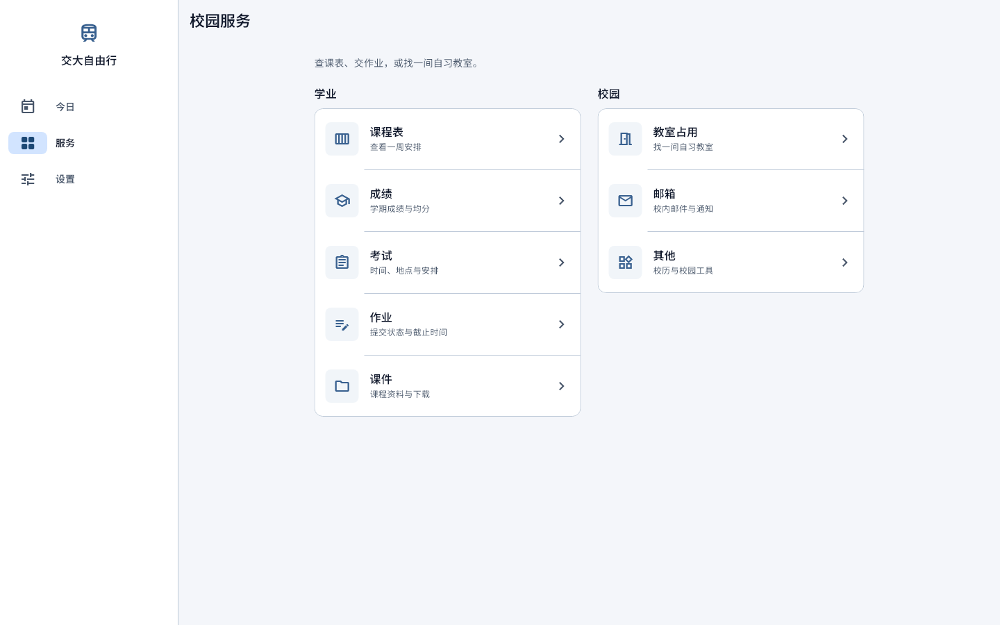
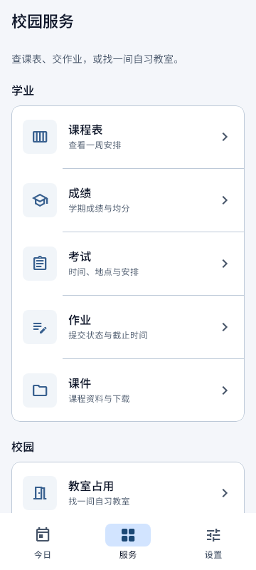
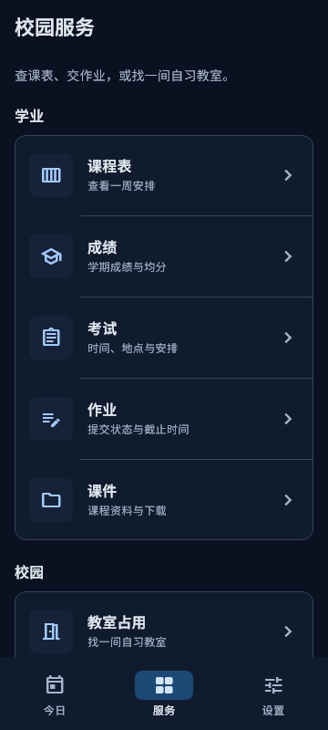
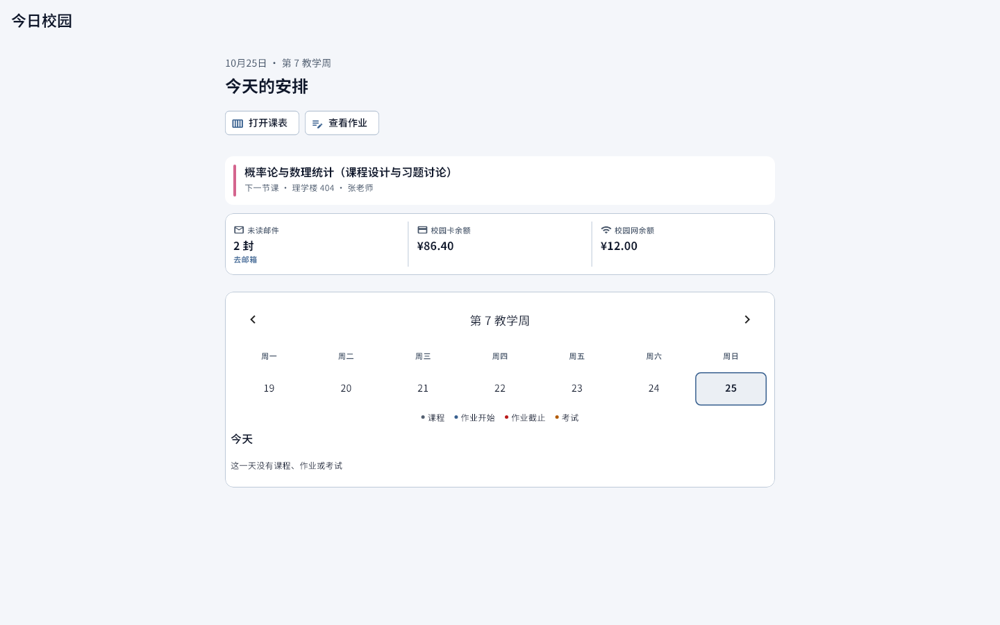
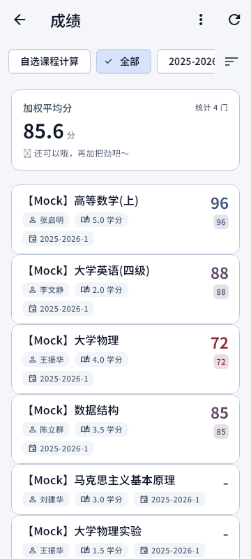

# Flutter Shadcn UI：本项目的视觉参考

选用日期：2026-10-25。

- 上游项目：[nank1ro/flutter-shadcn-ui](https://github.com/nank1ro/flutter-shadcn-ui)。
- 官方组件演示：[Flutter Shadcn UI docs](https://mariuti.com/flutter-shadcn-ui/)。
- 固定版本：`4fe5440765d4faf1855f3a2c456052b4121b3424`。
- 许可证：MIT，原文见本目录 `LICENSE`。
- 完整源码已下载至：`D:/Flutter/bjtuselfserviceaio/build/design-references/flutter-shadcn-ui/`。
- 原始克隆备份：`C:/Users/Miracle/AppData/Local/Temp/bjtu-flutter-shadcn-ui/`。

`build/` 中的完整源码会被 `flutter clean` 清理；临时目录也可能被系统清理。这里保留许可证、上游 README、Slate 配色与默认主题源码文本，以便在版本控制中追溯参考。需要重新下载完整源码时：

```powershell
git clone https://github.com/nank1ro/flutter-shadcn-ui.git build/design-references/flutter-shadcn-ui
git -C build/design-references/flutter-shadcn-ui checkout 4fe5440765d4faf1855f3a2c456052b4121b3424
```

## 这个项目包含什么

这是 shadcn/ui 设计语言的 Flutter 实现，包含组件库、交互示例、文档和组件测试。现成组件包括按钮、输入与表单、卡片、日历与日期选择、表格、标签页、菜单、对话框、Sheet、提示、徽章、进度与响应式工具。它提供视觉系统和通用组件，校园登录、课表和成绩等业务由本项目现有实现负责。

本次阅读的具体依据：

- `slate.dart.txt`：上游 `lib/src/theme/color_scheme/slate.dart`，浅深色的背景、前景、卡片、弱化文字、边框、焦点等语义色。
- `default_theme_variant.dart.txt`：上游 `lib/src/theme/themes/default_theme_variant.dart`，按钮层次、卡片边框、间距与圆角。上游卡片为 8dp 圆角、24dp 内边距、1dp 边框并带轻阴影。
- 完整源码中的 `example/lib/pages/`：每种组件的实际使用示例。
- 完整源码中的 `test/src/components/goldens/`：组件渲染样例。

## 风格是什么

可概括为「现代极简工具界面」：中性色承担大面积背景，清晰的标题与正文组织信息，细边框划分区域，小圆角控制视觉重量，主按钮、次按钮与弱操作有明确层次。浅色以白与浅灰为主，深色以深背景与浅文字为主。Slate 是其中一套偏冷的中性色方案，也能配置其他配色。

本项目据此采用「Slate 中性色 + 交大蓝」：保留交大的识别色与中文排版，适合每天反复查看课程、截止时间、成绩与邮件的校园工具。这里是对参考项目的视觉借鉴和现有 Material 组件主题化，没有添加 `shadcn_ui` 运行时依赖。

## 怎样结合现有项目

- 全局浅色：`#F4F6FA` 页面 + 白色内容面板 + `#0F172A` 正文。
- 全局深色：`#0B1120` 页面 + `#111B2E` 面板 + `#E2E8F0` 正文。
- 品牌：继续由 `#1B5E9C` 生成 Material 强调色，主操作和导航选中态使用这套蓝色。
- 边框：采用实色细线，输入交互边框比普通分隔线更清楚；保留现有对比度底线。
- 圆角：按钮与输入 8dp、卡片 12dp、弹层 16dp。这里比上游卡片更宽松，以容纳中文和手机触控。
- 字体：继续使用本地 Noto Sans SC、现有字号层级和等宽数字。
- 导航：保留今日 / 服务 / 设置，手机底栏、平板侧栏、桌面展开侧栏；两种导航统一使用蓝色选中态。
- 服务目录：保留学业 / 校园分组，服务图标采用中性色底与蓝色图标。
- 成绩、考试、作业、课件、邮箱与设置：通过现有 ColorScheme、Card、输入、按钮、Chip、分段按钮和菜单主题继承同一视觉语言。
- 成绩、考试和作业的顶部摘要：移除各页自绘渐变，使用相同的实色面板、细边框及正文 / 次文字语义色，并通过页面测试检查实际文字对比度。
- 可访问性：保留 48dp 触控目标、系统字号放大和浅深色切换。上游较小的视觉尺寸不直接用于缩小手机命中区。

视觉统一现已覆盖全部 16 个已启用页面，包括账号、设置、教学楼、工具、日志、项目动态与邮箱。普通列表上限 840，课表 / 教室 / 邮箱上限 1200；设置与资料使用 `AppSection`，错误恢复、登录提示与兜底空态使用可滚动的 `AppStatusView`。菜单、日期选择、进度、图标按钮及浮动按钮也使用共享主题。

本轮还修复了页面检查发现的项目动态初始化断言、动态数字大字号溢出、邮箱日期挤压，以及邮箱选中背景的 Material 绘制层问题。课程色、状态含义与业务操作保留现有实现。

## 验证

主题检查包括浅深色阅读对比度、品牌种子变化后中性阅读区域保持稳定、输入与按钮圆角、导航选中态与触控尺寸。现有响应式与界面测试覆盖登录、首页、服务及成绩、考试、作业、课件等业务页面。

2026-10-25 第一轮视觉统一的执行结果：

- 主题、视觉对比度、主题切换、导航交互与设计 token：58 项通过。
- 页面渲染、响应式布局、首页状态条：40 项通过。
- `flutter analyze --no-pub`：No issues found。
- 页面测试覆盖 360 / 412 / 820 / 1440 等窗口、浅深色与 1.0 / 2.0 字号；导航检查还覆盖 599/600、1199/1200 等断点。
- 截图采用 Flutter 实际渲染、项目中文字体和测试注入的样例数据；已目视检查代表页面。它们是设计预览，不是像素级 golden 断言。
- 前两次重叠运行的 Flutter 测试进程提前退出，日志为 `did not complete`。改为单进程串行执行后，上述 40 项全部通过；同一工作区的 Flutter 测试应依次执行。
- 本次未进行真机验收或学校账号联网验收。

全项目一致性补充验证：

- `ui_redesign_test.dart` 新增账号、设置、教学楼、工具、日志、项目动态、邮箱的 360 / 1440 宽度 × 浅深色 × 1 / 2 倍字号检查，以及分组面板和错误恢复按钮检查。
- 全页面渲染与交互 39 项通过；主题、导航、对比度、token 与响应式组件 63 项通过；首页状态、教学楼、教室与弹层 33 项通过，共 135 项。`flutter analyze --no-pub` 无问题。最终结果见 `build/ui-unification-core-tests.log`、`build/ui-unification-remaining-tests.log` 与 `build/ui-unification-final-analyze.log`。
- 本轮附加截图导出在测试进程中停滞，已停止；下方截图仍为第一轮留档。新增页面通过布局和交互测试，不把旧截图作为本轮新页面的目视验收记录。

重现检查：

```powershell
flutter test test/app_theme_test.dart test/app_visual_contrast_test.dart test/theme_switch_test.dart test/ui_compliance_test.dart test/design_token_lint_test.dart
$env:UI_REVIEW = '1'
flutter test test/ui_redesign_test.dart test/responsive_layout_test.dart test/home_status_strip_test.dart --concurrency=1
flutter analyze --no-pub
```

## 本项目实际预览

以下为现有 BJTU 应用套用该视觉方案后的界面。

桌面服务目录：



手机浅色与深色服务目录：





首页与成绩页面：




